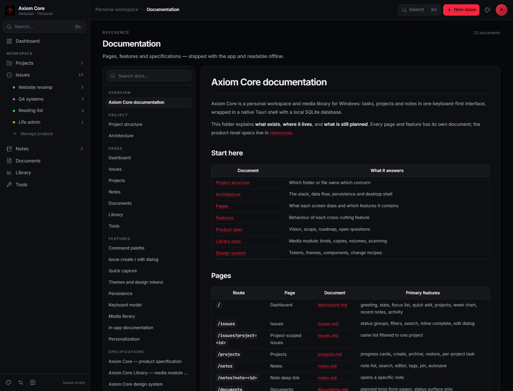

# Axiom Core

**A private, local-first workspace for independent work.**

Axiom Core is a desktop app for freelancers and individuals who need one place for projects,
tasks, notes, documents and a personal media library — without an account, a subscription or a
browser tab. Your work lives in SQLite on your machine.


> **Status:** personal beta. Projects, tasks, documents, notes, milestones, themes, settings and a
> paginated media library (one entry per series, English/Arabic/Anime categories) are working.
> Metadata providers and the remaining utility tools are next.

## Why it exists

Most tools are built for teams and rented by the seat. A freelancer needs fewer features, used
deeply:

- **One workspace, not five tabs.** Client projects, task lists, notes, briefs and the media you
  already own sit beside each other.
- **Local first.** No account, no sync service, no telemetry. Close the app and nothing leaves.
- **Made for a desktop.** Tray-first, global quick capture, real windows and a keyboard-first
  command palette.
- **Yours to change.** Themes, identity, backgrounds and data live in the repo and on disk.

## What is inside

| Area | What it does |
| --- | --- |
| **Dashboard** | Greeting, open/overdue stats, focus list, quick add, project progress, weekly chart, activity |
| **Projects** | Colour-coded cards, target dates, progress, detail workspace, archive/restore, delete with item choices |
| **Tasks** | Nested subtasks, checklists, attachments, rich descriptions, hierarchy-aware drag sorting, context menus |
| **Milestones** | Due dates, status, linked tasks and completion rollup inside a project |
| **Documents** | Folder tree, child pages, rich-text editor, project/task links, search, deep links |
| **Notes** | Folder tree, rich-text notes, tags, pinning, project and task links |
| **Library** | One entry per series, Movies/Series → English/Arabic/Anime categories, poster grid, search and filters, rebuild with backup |
| **User / themes** | Profile, Classic/Paper/Terminal, local or per-page backgrounds, help, data reset |
| **Tools** | Local image resize, convert, tint and palette extraction |
| **Command palette** | `⌘K` / `Ctrl+K` to navigate, search or create |

## Desktop experience

- **Tray first** — *Quick capture*, *Open Axiom Core*, *Quit*. Closing the window destroys it; the
  app stays in the tray.
- **Global quick capture** — `Ctrl+Alt+Space` opens a 560×152 frameless capture window with an
  Inbox/project picker.
- **Single instance** — a second launch focuses the running app.
- **Offline** — the release binary serves embedded assets; no dev server needed.

## Stack

React 19 · TypeScript · Vite 8 · Tailwind CSS 4 (CSS-first tokens) · React Router 7 ·
lucide-react · Tauri 2 · Rust · SQLite (WAL, bundled).

No UI kit, no state library, no icon package beyond lucide. State is a typed reducer; persistence
is a snapshot into SQLite with a localStorage cache.

## Getting started

Requires Node **20.19+** (or 22.12+), pnpm, Rust and the Tauri prerequisites.

```bash
pnpm install
pnpm dev          # http://localhost:5273
pnpm typecheck
pnpm build
```

Desktop shell:

```bash
pnpm dev                                         # terminal 1 — Vite on 5273
cargo run --manifest-path src-tauri/Cargo.toml   # terminal 2
```

Release:

```bash
pnpm build
cargo build --release --features custom-protocol --manifest-path src-tauri/Cargo.toml
```

## Install

Installers are published on **[GitHub Releases](https://github.com/EngCode/axiom-core/releases)** —
they are not committed to the repository.

| Platform | Download |
| --- | --- |
| Windows x64 | NSIS `.exe` — per-user, no admin prompt |
| Linux x64 | `.deb` or AppImage |
| macOS (Apple Silicon / Intel) | `.dmg` |

- **Unsigned builds** — Windows SmartScreen may ask for *More info → Run anyway*; macOS Gatekeeper
  may require right-click → **Open**.
- First launch copies the bundled workspace seed, so the Axiom Core project and docs are already
  there.
- Data stays in the platform app-data folder (`%APPDATA%\com.axiom.core\axiom.db` on Windows);
  uninstalling does not delete it.
- Tagged releases are built by CI for all three platforms. See
  [installer.md](docs/features/installer.md) for the pipeline, local build commands and the test
  checklist.

### Environment overrides

| Variable | Effect |
| --- | --- |
| `AXIOM_START_HIDDEN=1` | Start in the tray without opening a window |
| `AXIOM_DATA_DIR=<path>` | Put `axiom.db` somewhere other than AppData |
| `AXIOM_WEBVIEW_DATA_DIR=<path>` | Keep the WebView2 profile outside AppData |

## Your data

- **SQLite** at `%APPDATA%\com.axiom.core\axiom.db`; WAL mode, versioned schema.
- **localStorage** cache (`axiom.state.v1`) for instant start and cross-window sync.
- Library copies store a path **relative to the volume**, never a drive letter.
- **Reset demo data** restores the seed workspace. Deleting `axiom.db` while the app is closed
  resets everything.
- No sync, no export yet — planned.

## Connect an AI client

Axiom Core exposes a loopback HTTP API for external AI tools:

1. Open **User → Local API**.
2. Copy the token and note the port (`47615` by default).
3. Connect any HTTP-capable client to `http://127.0.0.1:47615` with
   `Authorization: Bearer <token>`.
4. Read `/v1/snapshot` before writing; update tasks with `PATCH /v1/issues/{id}`.

If the port is busy, change it in the same card and restart Axiom Core. The API only binds
`127.0.0.1`; no data leaves the machine.

Full route list, curl examples and an agent prompt: [Local API guide](docs/resources/LOCAL-API.md).
## Documentation

The app ships its own offline documentation (`/docs`), and the source lives in `docs/`:

- [Documentation index](docs/README.md)
- [Project structure](docs/project-structure.md)
- [Architecture](docs/architecture.md)
- [Core API](docs/resources/CORE-API.md)
- [Design system](docs/resources/DESIGN.md)
- [Product spec](docs/resources/SPEC.md)



## Structure

```
src/
├── components/   shell, sidebar, topbar, primitives, issues, documents, context menus
├── lib/          types, store, derive, actions, core API, appearance, themes
├── pages/        dashboard, issues, projects, project detail, notes, documents, library, tools, settings
├── App.tsx       providers, routes, overlays
└── index.css     design tokens and base styles
src-tauri/        Rust shell, SQLite, tray, scanner, commands
docs/             in-app documentation and assets
```

## Roadmap

1. Rich task content: checklists, subtasks and attachments.
2. WYSIWYG editing for tasks, project briefs, notes and documents.
3. Note/document links to specific tasks.
4. A real Tools area (image resize/convert/tint and more) with profile moved to a User screen.
5. Configurable media scanner: path, depth, media type.
6. Export/import and a second window.

The detailed spec lives in [SPEC.md](docs/resources/SPEC.md); open questions are at the end of that
file.
