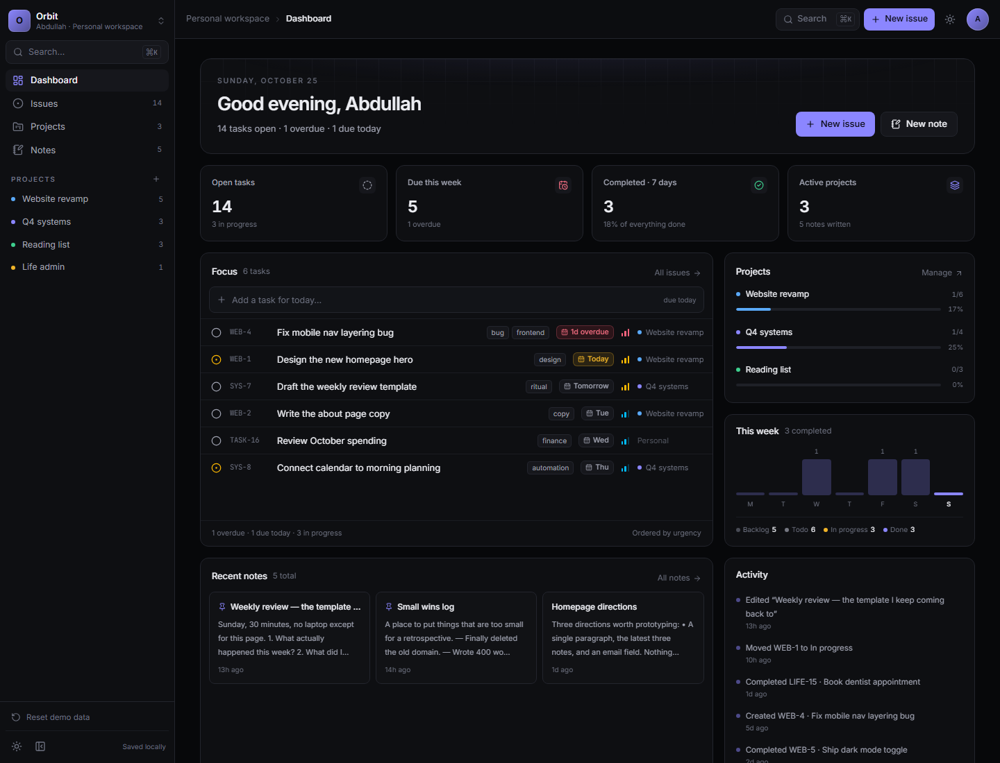

# Orbit — a personal workspace

A personal Linear/Notion hybrid: tasks, projects and notes in one quiet, keyboard-first
interface. Local-only, no account, no backend — your data lives in the browser.



> **Status:** v0.1 foundation. The dashboard, issue tracking, projects, notes, command palette
> and local persistence are working. The next steps are planned in [SPEC.md](docs/resources/SPEC.md).

## What is here

- **Dashboard** — time-aware greeting, open/overdue/completed stats, an urgency-ranked focus
  list with inline quick-add, project progress, a 7-day completion chart and an activity feed.
- **Issues** — grouped by status, filterable by project / priority / text, editable in a dialog,
  with Linear-style keys (`WEB-4`), priorities and due dates.
- **Projects** — colour-coded cards with progress, target dates, creation and archiving.
- **Notes** — two-pane editor with instant autosave, tags, pinning and an optional project.
- **Command palette** — `⌘K` / `Ctrl+K` to jump anywhere, search issues and notes, or create.
- **Themes** — dark by default, light on demand; the choice persists.
- **Seed data** — a realistic demo workspace, resettable from the sidebar.

## Stack

React 19 · TypeScript · Vite 8 · Tailwind CSS 4 (CSS-first tokens) · React Router 7 ·
lucide-react. No UI kit, no state library — a typed reducer plus `localStorage`.

## Getting started

Requires Node **20.19+** (or 22.12+) and pnpm.

```bash
pnpm install
pnpm dev          # http://localhost:5273
```

| Script | What it does |
| --- | --- |
| `pnpm dev` | Vite dev server with HMR on port 5273 |
| `pnpm build` | Typecheck, then build to `dist/` |
| `pnpm preview` | Serve the production build |
| `pnpm typecheck` | `tsc --noEmit` |

> **Windows note:** `pnpm-workspace.yaml` sets `nodeLinker: hoisted` and
> `packageImportMethod: copy` because the default symlinked layout fails on some
> Windows/antivirus setups. If an install still dies with `ERR_PNPM_SYMLINK_FAILED`, run
> `pnpm install --node-linker=hoisted --package-import-method=copy`.

## Keyboard

| Keys | Action |
| --- | --- |
| `⌘K` / `Ctrl+K` | Command palette |
| `C` | New issue |
| `⌘J` / `Ctrl+J` | New issue (alternate) |
| `↑ ↓ ↵` | Navigate / run a palette item |
| `⌘/Ctrl + Enter` | Save the issue dialog |
| `Esc` | Close dialog or palette |
| `Enter` | Add a quick task / commit a tag |

## Desktop app (Tauri shell)

The native shell lives in `src-tauri/`. Current behaviour:

- **Tray first** — the app stays resident with a tray icon: *Quick capture*, *Open Orbit*, *Quit*.
- **Global quick capture** — `Ctrl+Alt+Space` anywhere opens a frameless input window; `Enter`
  files a task due today, `Esc` or losing focus dismisses it.
- **Windows are disposable** — closing the main window destroys it (no hidden WebView2
  processes); the tray or a second launch recreates it.
- **Single instance** — launching Orbit again focuses the existing app instead of starting another.
- **First launch opens the window**; `ORBIT_START_HIDDEN=1` starts tray-only.

Measured on this machine, production build (`cargo build --release --features custom-protocol`):

| State | Result |
| --- | --- |
| Tray only, no window | 31.3 MB working set / 5.6 MB private, 0 WebView2 processes |
| Main window open | 6 WebView2 processes, ~325 MB working set / ~220 MB private |
| Window closed again | 0 WebView2 processes, app still running in the tray |
| Release binary | 11.1 MB, runs from embedded assets with no dev server |

The window number is a **development** measurement — the dev server, source maps and the React
dev build inflate it. Measure a production build before treating it as real.

### Running the desktop shell

```bash
pnpm dev                                         # terminal 1 — UI dev server on 5273
cargo run --manifest-path src-tauri/Cargo.toml   # terminal 2 — desktop shell
```

`pnpm tauri dev` also works and starts Vite itself, if `pnpm` is on your PATH.

| Variable | Effect |
| --- | --- |
| `ORBIT_START_HIDDEN=1` | Start in the tray without opening a window |
| `ORBIT_WEBVIEW_DATA_DIR=<path>` | Keep the WebView2 profile somewhere other than AppData |

The second one exists because a sandboxed terminal cannot write the default
`%LOCALAPPDATA%\com.orbit.desktop` profile; outside such a session it is unnecessary.

SQLite persistence is in place (`load_state` / `save_state` commands over a WAL database). The
Library module is next (see [LIBRARY.md](docs/resources/LIBRARY.md)); the browser build remains the fastest way
to iterate on the UI.

## Themes and design system

Three themes ship: **Orbit** (violet on near-black, default), **Paper** (warm editorial light,
serif headings, rust accent) and **Graphite** (neutral dark, cyan accent). Switch from the palette
icon in the sidebar or top bar, or `⌘K` → *Theme*. The choice is stored in `AppState` and in
SQLite, and the theme is applied before first paint.

- Tokens and theme blocks: `src/index.css` (every colour, radius and display font is a variable).
- Theme registry and legacy mapping: `src/lib/themes.ts`.
- Full system reference and change recipes: [DESIGN.md](docs/resources/DESIGN.md).

Two design explorations live in `design/` and are rendered for comparison:

| Direction | Image | Character |
| --- | --- | --- |
| Paper | `docs/style-paper.png` | editorial, serif, rust on cream, hairline rules |
| Terminal | `docs/style-terminal.png` | monospace, green-on-black, square, prompt-led |

They are static mockups, not shipped themes — useful for choosing a direction before spending
effort on a theme block.

## Documentation


- [Documentation index](docs/README.md) — pages, features and where their code lives
- [Project structure](docs/project-structure.md) — every folder and what belongs there
- [Architecture](docs/architecture.md) — stack, data flow, persistence, desktop shell
- [Pages](docs/pages/dashboard.md) — dashboard, issues, projects, notes
- [Features](docs/features/command-palette.md) — palette, dialogs, quick capture, themes, persistence
- [Resources](docs/resources/SPEC.md) — product spec, library spec, design system

## Structure

```
src/
├── components/   app shell, sidebar, topbar, UI primitives, issue row/dialog, palette
├── lib/          types · meta · seed data · store (reducer + persistence) · ui state · derive
├── pages/        dashboard · issues · projects · notes
├── App.tsx       providers, routes and global overlays
└── index.css     design tokens and base styles
```

Data is defined in `src/lib/types.ts`; derived values (counts, progress, focus ordering) live in
`src/lib/derive.ts` and are never stored.

## Your data

In the desktop app, state lives in **SQLite** at `%APPDATA%\com.orbit.desktop\orbit.db`
(override with `ORBIT_DATA_DIR`). The database runs in WAL mode, carries a versioned schema
(`PRAGMA user_version`) and mirrors the workspace: `projects`, `issues`, `notes`, `activity`.
The Library tables are already prepared — `media_kinds` (seeded with six editable kinds),
`media_items`, `volumes`, `media_copies`, `media_progress`, `tags` — even though that UI is
still ahead of us.

The browser build and the in-app cache still use `localStorage` (`orbit.state.v1`), which is
also what carries state between the main window and quick capture. Saves to SQLite are debounced
by 400 ms and sent as one snapshot per change — exact and simple at personal scale, to be
replaced by per-entity commands when the Library scanner lands.

**Reset demo data** restores the seed workspace in both stores. Deleting the database file while
Orbit is closed resets it completely. There is no sync yet — export/import is planned (see
[LIBRARY.md](docs/resources/LIBRARY.md)).

## Media data layer

The Library tables and commands exist ahead of the UI:

- `load_library` — kinds, items, copies, volumes, progress
- `save_media_item`, `attach_media_copy`, `upsert_volume`

They live in `src-tauri/src/data/db.rs`, with TypeScript mirrors in `src/lib/library-types.ts`
and `src/lib/library-api.ts`. Six editable media kinds are seeded: movies, series, anime, games,
books, music. Copies store a `relPath` relative to their volume, never a drive letter.
## Planning

The product spec, decisions, non-goals and roadmap live in [SPEC.md](docs/resources/SPEC.md). Open questions at
the end of that file are the intended starting points for the next round of design.
