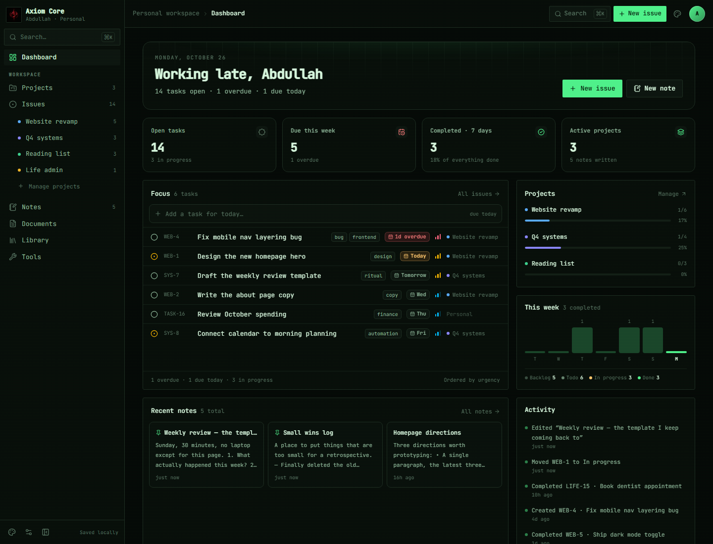

# Themes and design tokens

**Status:** shipped · **Sources:** [`src/index.css`](../../src/index.css),
[`src/lib/themes.ts`](../../src/lib/themes.ts),
[`src/components/theme-picker.tsx`](../../src/components/theme-picker.tsx) ·
**Full reference:** [DESIGN.md](../resources/DESIGN.md)

Every colour, radius and font in the UI is a semantic token. A theme is a set of values for those
tokens; components never know which theme is active.

## Shipped themes

| Theme | Mode | Character | Body font | Display font | Radius card / control |
| --- | --- | --- | --- | --- | --- |
| **Classic** | dark | crimson on near-black (default) | Inter | Inter | 12 / 8 px |
| **Paper** | light | warm paper, rust accent, editorial | Inter | Georgia | 6 / 4 px |
| **Terminal** | dark | phosphor green, square, monospace, faint scanline | JetBrains Mono | JetBrains Mono | 3 / 2 px |

## Switching

- **Settings → Appearance** shows theme cards with swatches (also reachable from Tools).
- Palette icon in the **sidebar footer** (opens upwards) or in the **top bar** (downwards).
- Command palette → *Theme: \<name\>* cycles to the next theme.
- `?theme=terminal` (or `paper`, `classic`) previews a theme on load without using the picker;
  useful for screenshots and design checks.

## How a theme applies

1. `index.html` runs a pre-paint script: reads `axiom.state.v1` (falling back to the legacy key),
   normalises the theme id, sets `data-theme` on `<html>` and toggles the `dark` class. No flash.
2. `AppProvider` repeats the logic when the theme changes.
3. CSS blocks `[data-theme='…']` define the values; Tailwind utilities such as `bg-surface`,
   `text-fg-muted`, `rounded-card` and `font-display` resolve through them.
4. The id is persisted in `AppState.theme` → localStorage and SQLite (`meta.theme`).

Legacy ids `dark`, `light`, `orbit`, `axiom` and `graphite` are mapped to `classic` / `paper` on
load, so old saves keep working.

## Adding a theme

1. Add a `[data-theme='key']` block in `src/index.css` with **all** tokens: canvas/surfaces, lines,
   foreground levels, accent trio, status colours, both radii and the sans/display fonts.
2. Add an entry to `THEMES` in `src/lib/themes.ts` (id, name, description, mode, three swatches).
3. Done: picker, palette, pre-paint script, previews and persistence read from that list.

## Design explorations

`design/terminal.html` started as a static mockup; the shipped **Terminal** theme turns that
direction into real tokens (monospace body, phosphor green, square radii, scanline).
`design/paper.html` informed the Paper theme.

## Background layer

Settings → Appearance can add a decorative layer behind the UI: grid, dots, glow or an image URL,
with 0–40 % opacity and a window/content scope. Patterns derive from the theme's foreground colour
(color-mix), images blend with soft-light. Values persist in meta and never overlay content.

## Known gaps

- No custom user themes or theme import/export.
- RTL works through logical utilities, but no Arabic copy yet.
- Theme-specific illustrations (beyond the logo) are not themed.
