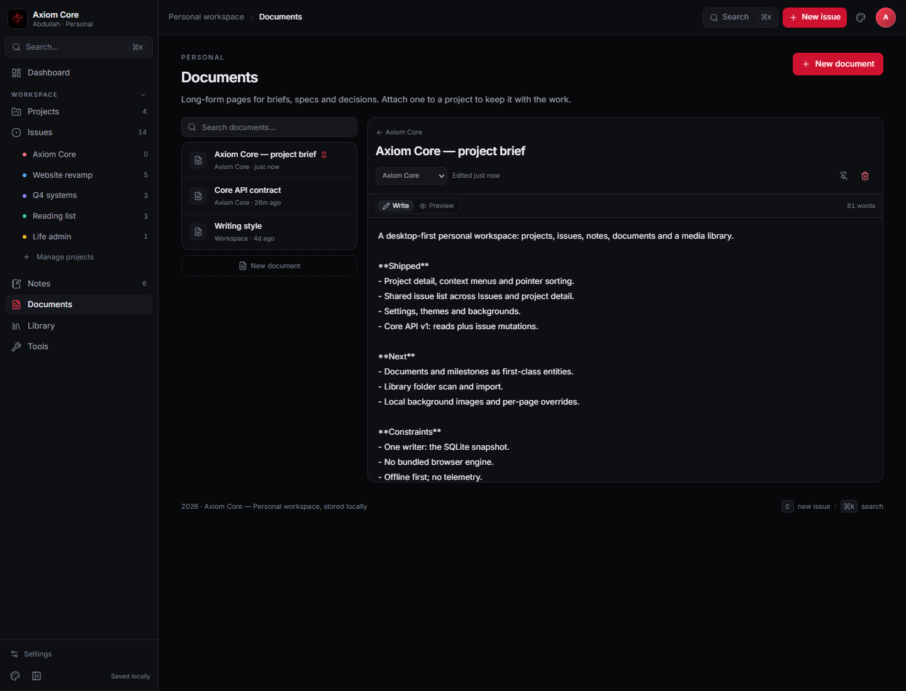

# Documents

**Route:** `/documents` · **Status:** shipped ·
**Source:** [`src/pages/documents.tsx`](../../src/pages/documents.tsx) ·
**List:** [`document-list.tsx`](../../src/components/document-list.tsx)

Documents are the long-form counterpart to Notes: briefs, specs and decision records that can live
inside a project.

## Editor

| Control | Behaviour |
| --- | --- |
| Title | inline, autosaves through `updateDocument` |
| Project | optional; assigns the document to a project |
| Write / Preview | Markdown source or rendered preview |
| Pin | keeps the document at the top of lists |
| Delete | confirmed; removes the document |
| Search | filters title and content |
| `?doc=<id>` | deep link to a document |

The list is shared with the project detail page: `DocumentList` owns the rows, project badges and
empty states.

## Project documents

- A document carries `projectId`; the project Documents tab filters by it.
- Creating from the project assigns the project and opens the editor.
- The same editor is used everywhere; there is no second document component.
- Documents are not notes: they have their own model and are not mixed into the Notes list.

## Storage

Documents live in `AppState.documents` and persist as JSON in the SQLite `meta` table under
`documents`. The snapshot writer remains the only writer.

## Known gaps

- No hierarchy, backlinks or table of contents yet.
- Markdown preview resolves relative links against the bundled docs, not the document graph.
- No export to PDF/Markdown.
- No collaborative history or versions.
