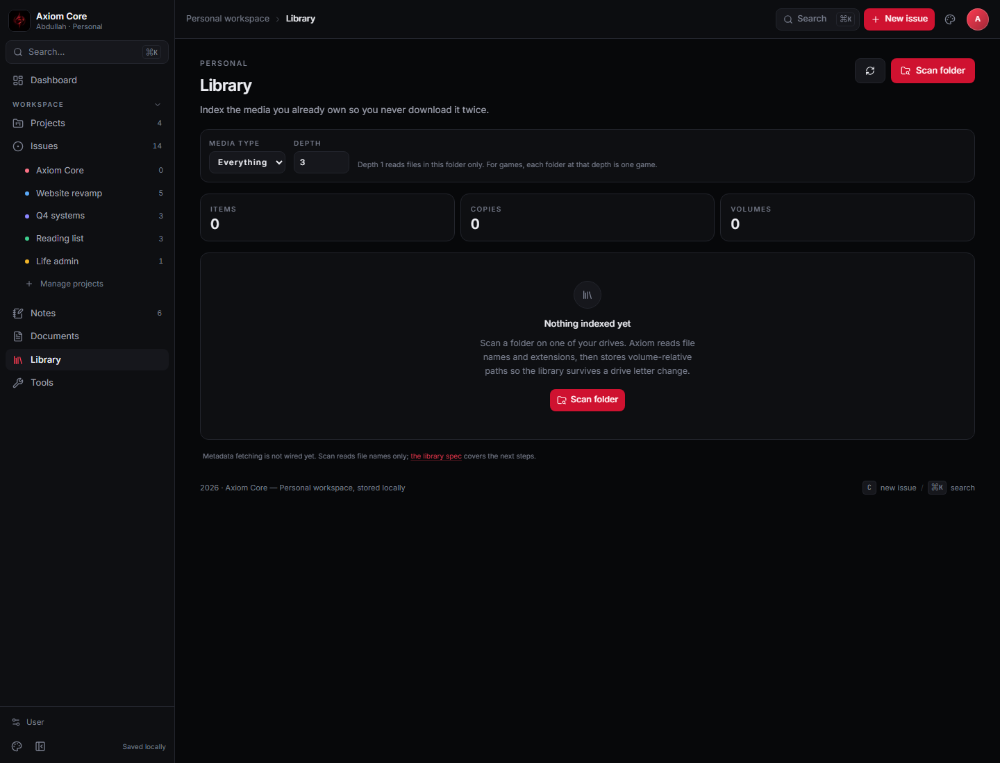

# Library

**Route:** `/library` · **Status:** scan/import MVP shipped ·
**Source:** [`src/pages/library.tsx`](../../src/pages/library.tsx) ·
**Feature doc:** [media-library.md](../features/media-library.md) ·
**Spec:** [LIBRARY.md](../resources/LIBRARY.md)

The Library indexes media you already own so you never download it twice. The first milestone —
folder scan, review and import — is implemented.

## Scan flow

1. Choose **media type** and **depth**, then **Scan folder** to open the native folder picker (`rfd`).
2. Rust walks the folder recursively (5,000-file budget), classifies by extension and returns
   candidates with `relPath`, size, kind and volume root.
3. The page shows a review list; select all or individual files.
4. **Import** creates a `MediaItem`, a `MediaCopy` and, if needed, a `Volume`.
5. Refresh reloads the library snapshot.

### Classification

| Extensions | Kind |
| --- | --- |
| `mkv`, `mp4`, `avi`, `mov`, `m4v`, `webm`, `wmv` | `series` when the name matches `SxxExx`, otherwise `movies` |
| `epub`, `pdf`, `cbz`, `cbr`, `mobi` | `books` |
| `mp3`, `flac`, `m4a`, `wav`, `ogg` | `music` |

## Storage

- Volume-relative paths (`relPath`); the drive letter is not part of a copy.
- Volume root and label are recorded so a drive can be matched again.
- Library tables are separate from the workspace snapshot; `load_library`, `save_media_item`,
  `attach_media_copy` and `upsert_volume` own them.
- A scanner unit test covers recursive scan and classification.

## Limitations

- No GUID/serial volume identity yet; the mount path/label identify a volume.
- No metadata provider (TMDB/IGDB), covers or progress editing.
- Games are not scanned yet; executable detection needs a safer rule.
- Duplicate detection is by `volumeId + relPath`, not content hash.
- No progress/status editing UI beyond the imported `acquired` state.
