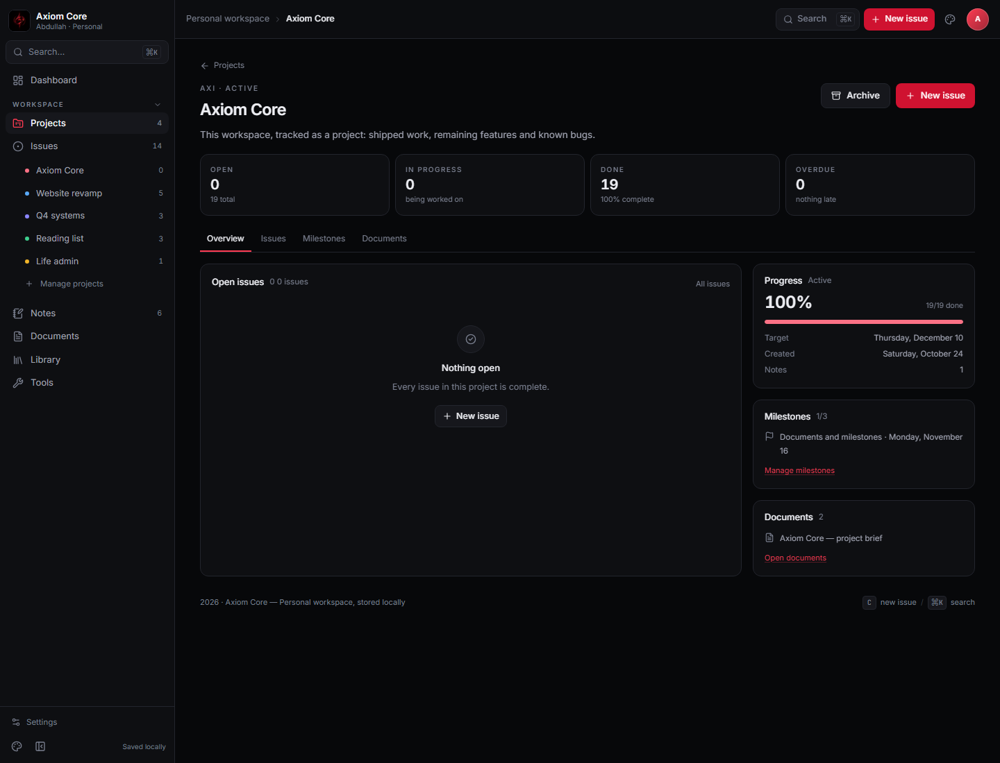
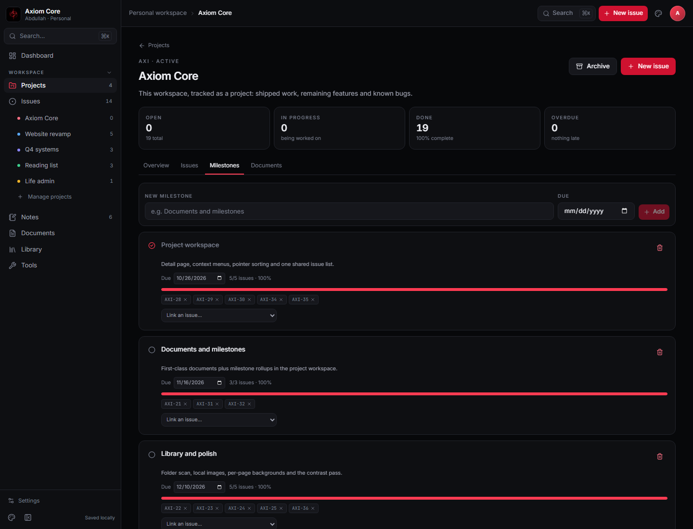
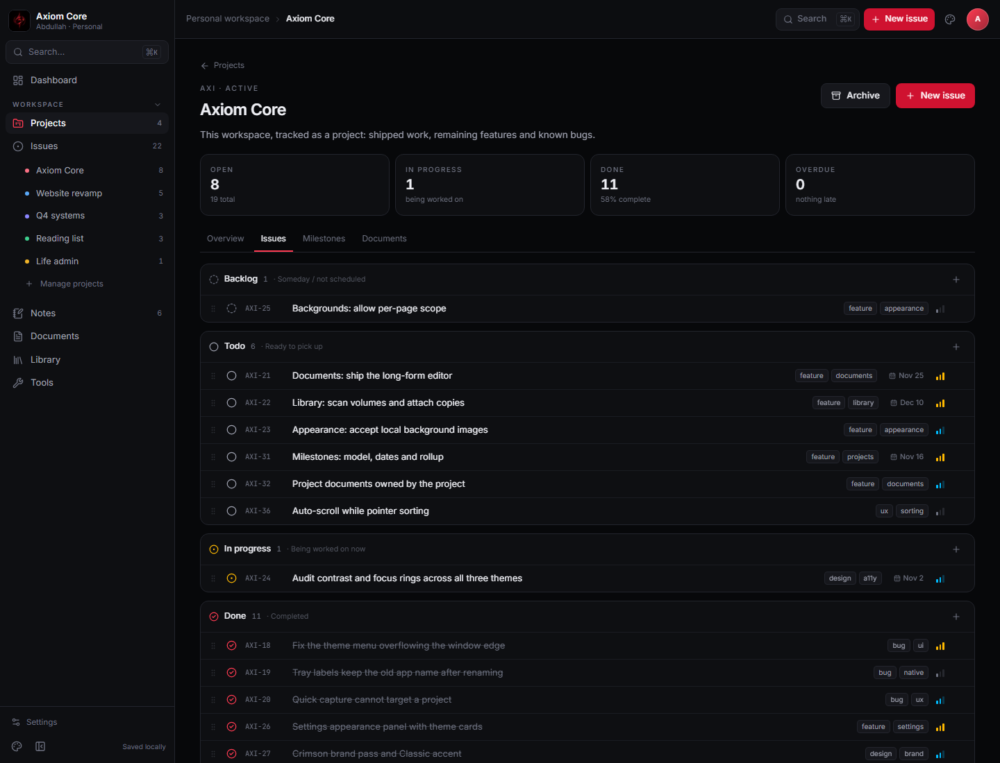
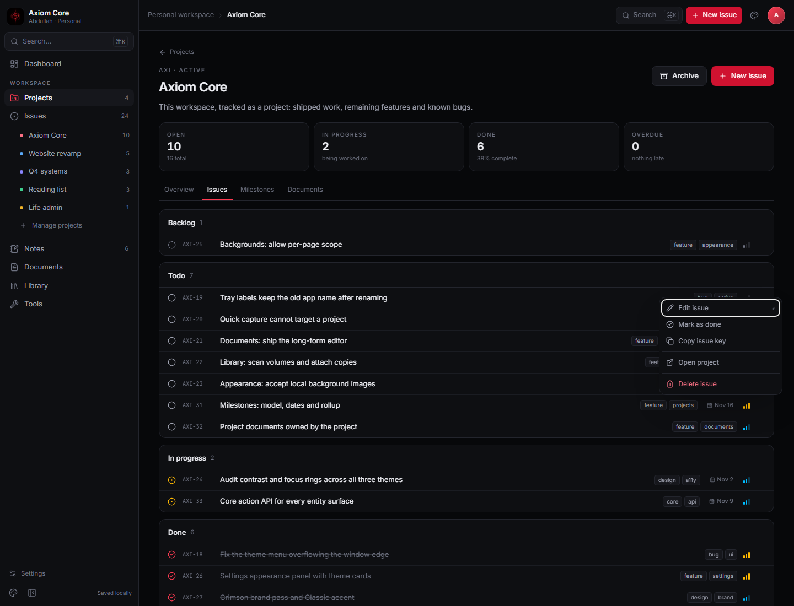

# Project detail

**Route:** `/projects/:projectId` · **Status:** shipped ·
**Source:** [`src/pages/project-detail.tsx`](../../src/pages/project-detail.tsx) ·
**Plan:** [PROJECT-WORKSPACE.md](../resources/PROJECT-WORKSPACE.md)

The project detail page is the project's home rather than a filtered issue list. It answers: what
is this, how far along is it, what is open, and what is next?

## Header

- Back link to Projects.
- Eyebrow: project key and status.
- Title and description.
- **Archive/Restore** and **New issue** actions.

## Stats

Four counters: open, in progress, done and overdue. Overdue compares the issue due date with today
and ignores completed issues.

## Tabs

| Tab | Content |
| --- | --- |
| **Overview** | Open issues (six most urgent), progress, target/created dates, note count, milestone and document summaries |
| **Issues** | Shared `IssueList`: grouped by status, add per group, drag reorder, inline complete and edit |
| **Milestones** | Due date, status, linked issues and completion rollup |
| **Documents** | Project-owned documents, created and opened in the shared editor |

Tabs are links (`?tab=issues`) so they are shareable and survive refresh.

## Interactions

- Project cards open this page from the title, the `Details` link and the context menu.
- Issue rows here use the same `IssueList`/`IssueRow` as the Issues screen: group add buttons, drag`n  handles, click to edit, circle to complete, right-click or `⋯` for actions.
- The page is read-only for project fields today; editing the project itself is a later dialog.

## Code map

- `src/pages/project-detail.tsx` — page, stats, tabs
- `src/components/issue-row.tsx` — shared issue surface
- `src/lib/actions.ts` — typed action contract for cards and menus
- `src/components/context-menu.tsx` — menu primitive
- `src/lib/derive.ts` — `projectProgress`

## Current limits

- Milestones link issues one-directionally; there is no issue-side milestone field.
- Project documents use the global Documents editor; no project-specific template yet.
- Project name, colour and target date are still not editable after creation.
