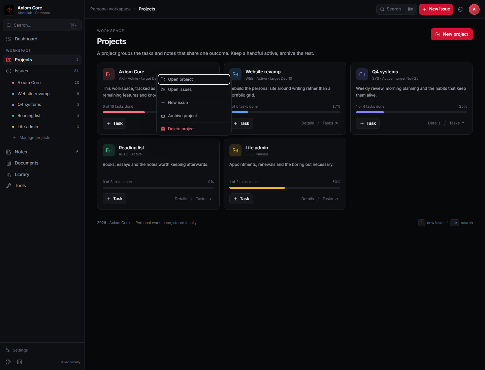
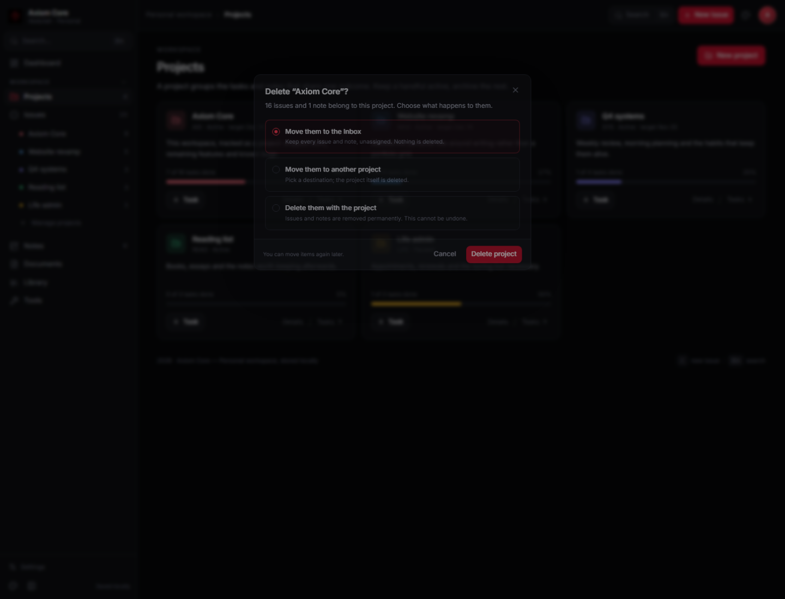
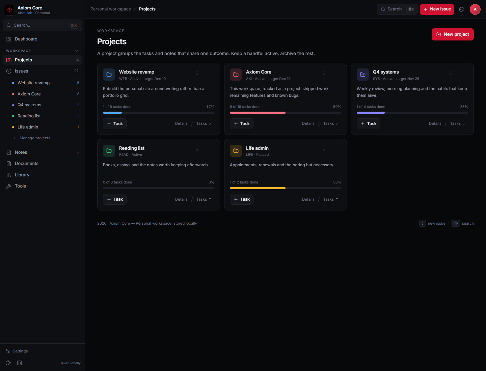
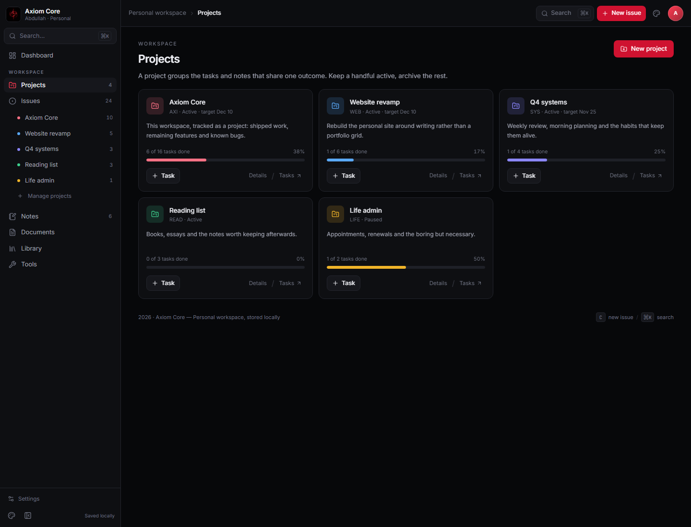
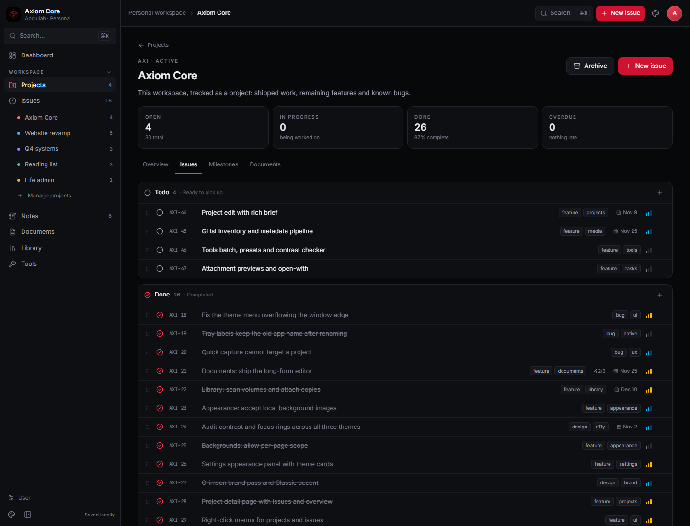

# Projects

**Route:** `/projects` · **Status:** shipped · **Source:** [`src/pages/projects.tsx`](../../src/pages/projects.tsx)

Projects group tasks around one outcome. The page manages their lifecycle: create, work, archive,
restore.

## Layout

- **Active grid** — every project whose status is not `done`, including paused projects (their
  status is shown as “Paused” on the card). Up to three columns; two at medium width.
- **Archived section** — a compact list of `done` projects with a restore action.
- **Create action** — *New project* in the header opens a dialog.

## Project card

| Element | Behaviour |
| --- | --- |
| Colour icon | project colour on a tinted background |
| Name, key, status | `WEB · Active` or `LIFE · Paused`, plus `target <date>` when set |
| Description | two lines, or “No description yet.” |
| Progress | `done of total tasks done`, percentage and a bar in the project colour |
| Task | opens the issue dialog pre-assigned to this project |
| Card body | left-click opens the project detail workspace |
| Details | navigates to `/projects/<id>` |
| Tasks | navigates to `/issues?project=<id>` |
| ⋯ / right-click | open, issues, new issue, archive/restore, delete |

Progress is derived from issues with that `projectId`; the bar is colour-coded per project, not
per completion state.

## Creating a project

| Field | Rules |
| --- | --- |
| Name | required; trimmed; also derives the issue-key prefix |
| Description | optional, trimmed |
| Colour | one of six swatches (violet, blue, emerald, amber, rose, cyan) |
| Target date | optional date input |

The dialog previews the derived key (`Website revamp` → `WEB-1`) using
`projectKeyFromName`: initials of up to three words, or the first four characters of a single
word. Keys are not editable after creation in this version.

## Archiving and restoring

- Archive sets `status = done`; the project moves to the archived section.
- Restore sets `status = active`; the project returns to the grid.
- Tasks are never deleted or reassigned by either action — they keep their `projectId` and remain
  visible on the Issues page.

## Deleting a project

- **⋯ → Delete project**, or right-click the card; archived rows also expose a trash button.
- A dialog asks what happens to the issues and notes:
  - **Move to Inbox** — keep everything, unassigned.
  - **Move to another project** — pick the destination project.
  - **Delete them with the project** — cascade delete, explicitly confirmed as permanent.
- Deletion is also available from the card's context menu in the archived section.
- There is no undo yet; the activity log records `Deleted project · <name>`.

## Reordering

- Drag a project card onto another card to place it before that project. Order is the state order
  and persists through the snapshot (rows load `ORDER BY rowid`).
- Project quick links in the sidebar follow the same order.
- Dragging is disabled from buttons and links inside the card, so Task/Details/Tasks/⋯ still work.
- Archived projects are not draggable.

## Empty states

- No active projects: “No projects yet” with a create action.
- No archived projects: the section is omitted entirely.

## Data

Reads `state.projects` and `state.issues`; progress comes from `projectProgress()` in
[`derive.ts`](../../src/lib/derive.ts). Creation, status changes and deletion go through
`addProject`, `updateProject` and `deleteProject` in the store.

## Known gaps

- No project edit dialog yet (name, colour, target date are fixed after creation).
- Paused is displayed but there is no control to pause/unpause yet.
- Notes cannot be filtered by project from this page.
## Example project

**Axiom Core** is tracked in the workspace itself, so the roadmap and the bug list live where the work
happens rather than in a separate document. It uses the `AXI` key and the rose project colour.

- 10 issues: 3 done, 5 todo, 1 in progress, 1 backlog.
- Bugs are labelled `bug`; features are labelled `feature`; design/audit work uses `design`.
- AXI-18 records the top-bar theme menu overflow, including the fix.

