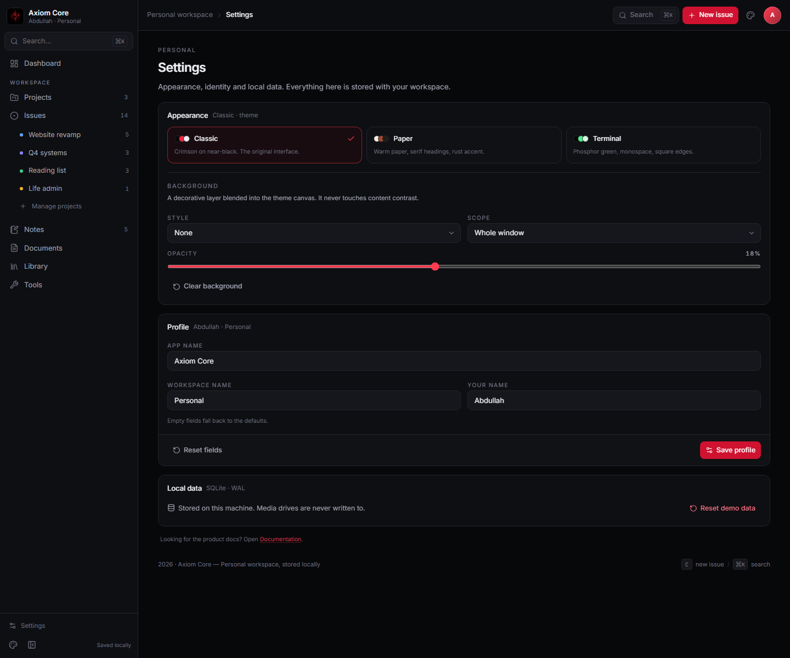
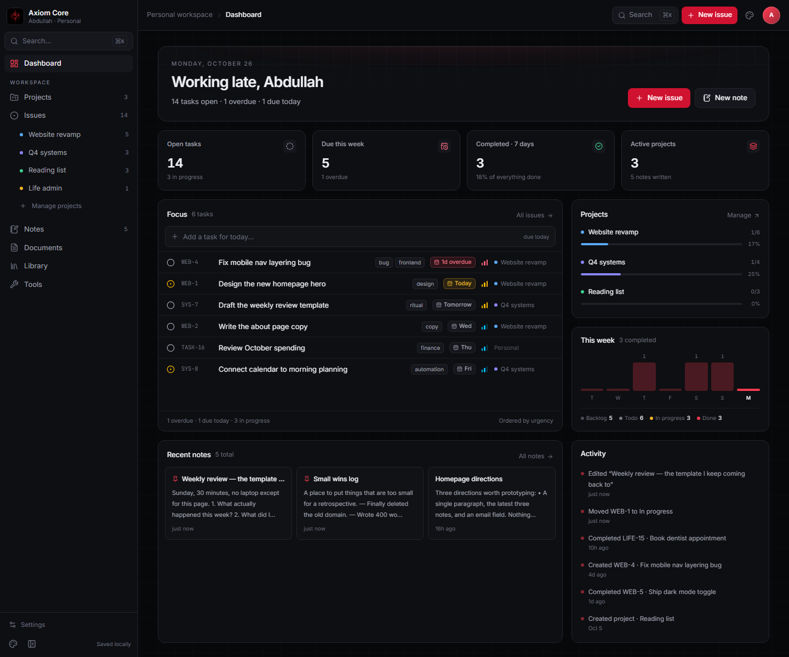

# Settings

**Route:** `/settings` · **Status:** shipped ·
**Source:** [`src/pages/settings.tsx`](../../src/pages/settings.tsx)

Settings is the home for appearance, identity and local data. It is reachable from the sidebar
footer, the top-bar avatar, the command palette and the Tools page.

## Appearance

### Themes

Three cards show the shipped themes with a colour swatch and description. Clicking a card applies
the theme immediately:

| Theme | Character |
| --- | --- |
| **Classic** | crimson on near-black, the default |
| **Paper** | warm paper, serif headings, rust accent |
| **Terminal** | phosphor green, monospace, square edges |

Theme details live in [themes.md](../features/themes.md).

### Background

A decorative layer is blended into the current theme canvas:

| Control | Options |
| --- | --- |
| Style | None · Grid · Dots · Glow · Image |
| Scope | Whole window · Page content |
| Opacity | 0 – 40 %, in 2 % steps |
| Image URL | shown only for the Image style; blended with `soft-light` |`n| Choose image | local file, resized to 1600 px JPEG and stored locally |`n| Apply to | Everywhere or the current page |

- Patterns use `color-mix` against the theme's foreground colour, so they adapt to every theme.
- The layer is `pointer-events: none`, sits behind the UI, and never covers content.
- Cards remain opaque, so the background is visible in page gutters, the hero and empty areas.
- Values persist in `meta` (`appearance.backgroundKind`, `.imageUrl`, `.opacity`, `.scope`) and per-page overrides in `appearance.pageBackgrounds`.

## Profile

App name, workspace name and owner name, with a live subtitle in the card. Empty fields fall back
to the defaults in `src/lib/identity.ts`. Saving updates the whole shell and the native window
title. See [personalization.md](../features/personalization.md).

## Local data

A single destructive action: **Reset demo data** (confirmed). It restores the seed workspace,
including identity and appearance, and never touches media drives.

## Code map

- `src/pages/settings.tsx` — page composition
- `src/lib/appearance.ts` — defaults, options and normalization
- `src/lib/store.tsx` — `updateBackground`, `updatePageBackground`, `updateIdentity`, `resetData`
- `src/components/app-background.tsx` — the actual layer and pattern builder

## Known gaps

- Local images are stored as data URLs; large art is downscaled to 1600 px JPEG first.
- One background per page path; there is no layer stack or blend editor.
- No custom accent editing per theme yet.
